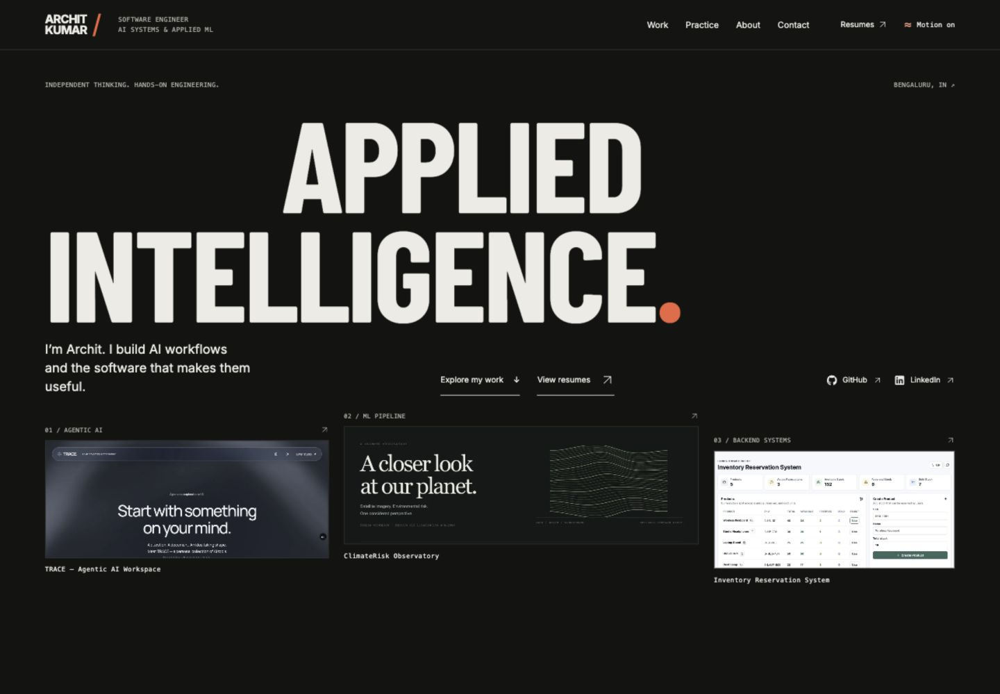

# Archit Kumar · AI & Software Engineer

**Applied intelligence. Built with intent.**

My portfolio brings together the AI applications, backend systems and evaluation work I’ve built. Each featured project explains the problem, the implementation decisions, how failures are handled, and what the results do—and do not—establish.

[Visit my portfolio](https://portfolio-updated-ak.vercel.app/) · [LinkedIn](https://www.linkedin.com/in/archit-k20) · [GitHub](https://github.com/Archit-k20) · [Email](mailto:architk5856@gmail.com)



## About me

I’m Archit, a software engineer focused on AI workflows and the systems that make them useful: retrieval, APIs, document processing, verification and dependable backend behavior.

- **Xelron.ai · May–October 2026:** SDE Intern in Agent Evaluation & Benchmark Engineering, promoted to Team Lead. Led a 10-member authoring team; 87% approval across four workstreams.
- **Independent contract work:** terminal-benchmark engineering with 120 approved submissions out of 122, plus a separate Go static-analysis engagement.
- **IBM · May–July 2025:** GenAI Intern — WatsonX Training Program.
- **VIT · May 2026:** B.Tech in Computer Science, GPA 8.45; AI/ML Club leadership.

I’m interested in AI engineering and software engineering roles, as well as freelance projects involving applied AI, backend services and workflow automation.

## Selected work

| Project | What the portfolio explores | Source |
| --- | --- | --- |
| **TRACE — Agentic AI Workspace** | A deployed workspace for research, documents, code and media; hybrid retrieval, source evidence and observable processing stages. | [Repository](https://github.com/Archit-k20/Agentic-Workflows-GenAI-) |
| **ClimateRisk Observatory** | Satellite-analysis workflows, queued processing, durable report records, explicit demo mode and model-verification boundaries. | [Repository](https://github.com/Archit-k20/Climate-Observatory) |
| **The Shape of Health** | An educational health workspace with source-traceable report findings, confirmed model inputs, SHAP explanations and reviewable summaries. | [Repository](https://github.com/Archit-k20/AI-Powered-Health-Prediction-Web-App) |
| **Inventory Reservation System** | Transactional stock reservations, order confirmation and failure flows using Spring Boot, PostgreSQL, Redis and Kafka. | [Repository](https://github.com/Archit-k20/Inventory-Reservation-System) |
| **CRM Analytics Dashboard** | Sales-lifecycle analysis with filters, pipeline metrics and conversion reporting using Python, Streamlit and MySQL. | [Repository](https://github.com/Archit-k20/CRM-Dashboard) |

The three featured builds have dedicated case studies:

- [TRACE](https://portfolio-updated-ak.vercel.app/projects/genai-assistant)
- [ClimateRisk Observatory](https://portfolio-updated-ak.vercel.app/projects/climate-risk)
- [The Shape of Health](https://portfolio-updated-ak.vercel.app/projects/ai-doctor)

Screenshots retain their sample-data context. Model evaluation results are explained alongside their methodology and limitations; they are not presented as customer impact or clinical validation.

## The portfolio itself

The site uses an editorial layout: oversized type, warm paper and charcoal surfaces, real product imagery, and architecture diagrams that explain the work behind each interface.

- Smooth desktop scrolling with **Lenis**, **GSAP** and measured sticky chapters.
- Native touch scrolling, a visible motion toggle and support for system reduced-motion preferences.
- **Interface / Under the hood** project views and keyboard-operated screenshot galleries and explanatory scenarios.
- Dedicated case-study routes, anchor navigation and browser Back restoration.
- Two clearly labelled resume options: **AI / GenAI Engineering** and **Software Engineering**, each with view and download actions.
- Responsive WebP images, local fonts and lazy-loaded case studies.
- Email and copy-address contact actions, with an optional validated EmailJS form.

### Stack

React 18 · Vite · React Router · Tailwind CSS/custom CSS · Lenis · GSAP ScrollTrigger · Framer Motion · EmailJS

The active design uses HTML, CSS and SVG. Legacy Three.js packages remain in the existing lockfile, but the portfolio does not load a 3D scene.

## Run locally

Use **Node.js 24** and npm.

```sh
git clone https://github.com/Archit-k20/archit-kumar-portfolio.git
cd archit-kumar-portfolio
npm ci
npm run dev
```

Open the local URL printed by Vite, normally `http://localhost:5173`.

```sh
npm test          # Content, resume, contact and scroll-policy checks
npm run build    # Production files in dist/
npm run preview  # Preview the production build locally
```

Contact tests mock delivery; they do not send email. The optional `python3 tests/serve-review.py` server serves `dist/` on port 5174 with responsive/motion QA fixtures.

## Project structure

```text
src/portfolio/
  content.js          Profile, experience, projects, evidence and resume links
  Portfolio.jsx       App shell, navigation and homepage
  Sections.jsx        Project chapters, experience and background
  CaseStudy.jsx       Lazy-loaded engineering case studies
  ProjectGallery.jsx  Accessible screenshot tabs
  Scroll.jsx          Lenis/GSAP integration and navigation restoration
  motion.jsx          Motion preferences and reduced-motion handling
  Resumes.jsx         Shared resume chooser
  ContactSection.jsx  EmailJS form and direct-contact fallback
  ui.jsx              Architecture diagrams and explanatory scenarios
public/
  images/             Project screenshots and identity assets
  fonts/              Locally hosted fonts and their licences
  resume/             The two downloadable PDFs
```

Update `src/portfolio/content.js` to maintain portfolio content. Keep project screenshots factual and update their captions and evidence links together. GSAP controls scroll-linked wrappers; Framer Motion controls separate interface elements.

## Optional contact form

Without EmailJS configuration, email and copy-address actions work immediately. To enable the form, copy `.env.example` to `.env.local` and configure all three values:

```dotenv
VITE_APP_EMAILJS_SERVICE_ID=
VITE_APP_EMAILJS_TEMPLATE_ID=
VITE_APP_EMAILJS_PUBLIC_KEY=
```

The EmailJS template expects `from_name`, `email` and `message`. Restart Vite after changing local configuration. On Vercel, set the same variables in project settings and redeploy. `VITE_` values are included in the browser bundle; never place private API keys in them.

## Deployment

Hosted on Vercel at [portfolio-updated-ak.vercel.app](https://portfolio-updated-ak.vercel.app/).

`vercel.json` specifies the Vite build, `dist/` output and SPA rewrite so case-study links work when opened directly or refreshed. Import this repository into Vercel with the repository root as the project directory. See [deployment notes](docs/DEPLOYMENT.md) for validation and rollback.

## Credits and licence

Built and maintained by **Archit Kumar**. Code is available under the [MIT licence](LICENSE). Self-hosted font licences are included in `public/fonts/`; project screenshots and branding retain their respective ownership and attribution.
